# FittingMES Quick Guide

คู่มือนี้อธิบายการบันทึกข้อมูลตั้งแต่ WET จนถึง DRY และการพิมพ์รายงาน ให้ตรวจสอบวันที่และ Lot ก่อนกดบันทึกทุกครั้ง

ภาพประกอบเป็นหน้าจอจริงจากข้อมูลวันที่ 04/09/2026 ใช้เพื่อชี้ตำแหน่งเมนูและช่องข้อมูลเท่านั้น ภาพแสดงข้อมูลที่มีอยู่แล้ว และไม่ได้กดบันทึกหรือเปลี่ยนแปลงข้อมูล

## 1. WET SIDE - PRODUCTION

1. เลือก `Production Date` ให้ตรงกับวันที่ผลิต
2. เลือก `Production Lot` ที่ต้องการบันทึก
3. กรอก `Counter` และ `Curing` เป็นจำนวนจริง
4. ตรวจค่า `Wet Reject` ซึ่งระบบคำนวณจากยอด Counter/Curing และ Reject ที่บันทึกไว้แล้ว ไม่ต้องกรอกยอดคำนวณเอง
5. ตรวจสอบ Lot และตัวเลข แล้วกด `SAVE`

**ข้อควรระวัง:** `Curing` ต้องไม่มากกว่า `Counter` และต้องไม่มากกว่า `Counter` ลบยอด Wet Reject ที่บันทึกไว้ หากบันทึกไม่ได้ ให้ตรวจวันที่/Lot และแก้ยอดให้สัมพันธ์กันก่อน

`Curing` ในหน้านี้คือยอดผลิตจาก WET ไม่ใช่ยอด Depallet ใน DRY

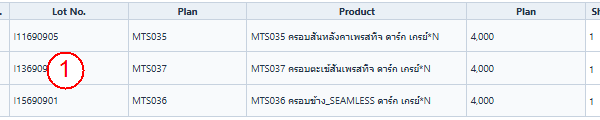

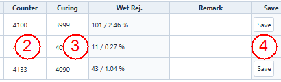

หมายเลข: 1 Lot · 2 Counter · 3 Curing · 4 SAVE

## 2. WET SIDE - PRESS PRODUCTION

1. กด `ADD FITTING`
2. เลือก `Shift`, `Press` และ `Mould` ให้ตรงกับการผลิต
3. กรอกจำนวนผลิตของแต่ละ Press ในช่องของ Press นั้น ตรวจสอบว่าไม่กรอกสลับเครื่อง
4. กด `LOG CAL` เพื่อคำนวณค่าที่หน้าจอแสดง ตรวจผลก่อนบันทึก
5. ตรวจทานผล แล้วกด `SAVE`

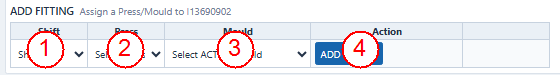

หมายเลข: 1 Shift · 2 Press · 3 Mould · 4 ADD FITTING

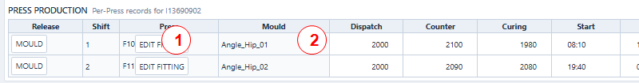

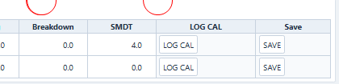

หมายเลข: 1 Press · 2 Mould · 3 LOG CAL · กด SAVE หลังตรวจผล

## 3. WET SIDE - LOGGER

1. เลือก `Machine` และ `Instance` ที่ต้องการบันทึก
2. กรอกเวลา `Start` และ `End` ของเหตุการณ์ แล้วระบุ `Min`
3. เลือก `Type` และ `Cause` ให้ตรงกับเหตุการณ์จริง
4. ตรวจสอบข้อมูลและกด `SAVE`

**BD:** เหตุการณ์ประเภท BD ต้องมีระยะเวลาอย่างน้อย **10 นาที** ระบบไม่ยอมรับ BD ที่น้อยกว่า 10 นาที ตรวจเวลาเริ่ม/จบและ `Min` ให้ถูกต้อง หากยังไม่ถึง 10 นาที ให้เลือกประเภทที่ถูกต้องตามเหตุการณ์จริง ไม่ควรเลือก BD เพื่อหลีกเลี่ยงการตรวจสอบ

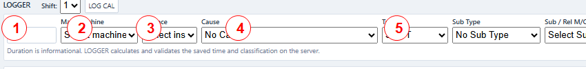

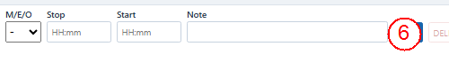

หมายเลข: 1 Min · 2 Machine · 3 Instance · 4 Cause · 5 Type · 6 SAVE

## 4. WET SIDE - REJECT

1. เลือก `Shift`, `Line`, `Product/Lot` และ `Source`
2. กรอก `Qty` และเลือก `Reject Reason` ให้ตรงกับชิ้นงานเสียและแหล่งที่มา
3. กด `SAVE`
4. ใช้ `REJECT CAL` เพื่อตรวจยอด Reject แยกตาม Reason และยอดรวมของรายการใน workflow ที่เลือก
5. หากยอดไม่ตรงกับที่นับ ให้ตรวจ Lot, Source, Reason และ Qty ของรายการที่เกี่ยวข้อง

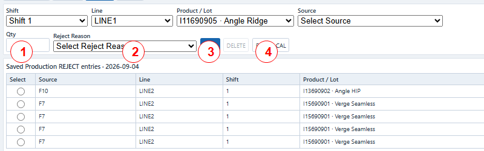

หมายเลข: 1 Qty · 2 Reject Reason · 3 SAVE · 4 REJECT CAL

## 5. DRY SIDE - DEPALLET

1. เลือก `Production Date` ซึ่งเป็นวันที่ทำ Depallet
2. เลือก Production Lot ที่ผลิตแล้ว ระบบแสดงยอดผลิตจาก `Curing` และยอดคงเหลือให้อ้างอิง
3. กรอก `Depallet Qty` ตามจำนวนที่นำออกจากกระบวนการ
4. กรอก `Good Qty` ตามจำนวนชิ้นงานดี
5. ตรวจยอดและกด `SAVE DEPALLET`

จำนวน `Depallet Qty` ต้องไม่เกินยอด Curing ที่ยังเหลือ ระบบคำนวณยอดคงเหลือจากประวัติ Depallet และอาจเตือน/จำกัดจำนวนที่กรอก ส่วนยอด Reject ที่จัดประเภทแล้วต้องไม่เกินส่วนต่างระหว่าง Depallet กับ Good ระบบคำนวณ `R99` เป็น Reject ที่ยังไม่จัดประเภท

**อย่าสับสน:** ยอด `Curing` ที่กรอกใน WET เป็นยอดผลิตต้นทาง ส่วน `Depallet Qty` และ `Good Qty` เป็นยอดที่บันทึกภายหลังใน DRY

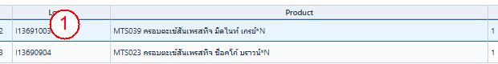

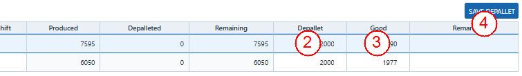

หมายเลข: 1 Production Lot · 2 Depallet Qty · 3 Good Qty · 4 SAVE DEPALLET

## 6. DRY SIDE - REJECT

1. เลือก `Shift`, `LINE_DRY1`, `Product/Lot` และ `Source`
2. กรอก `Qty` และเลือก `Reject Reason`
3. กด `SAVE`
4. ใช้ `REJECT CAL` เพื่อตรวจยอดรวมและจำนวนรายการ Reject ของ workflow ที่เลือก โดยรายงานนี้แสดงข้อมูลที่บันทึกในตาราง REJECT ใหม่เท่านั้น
5. ค่า Good ที่เหลือให้ตรวจจากรายการ Depallet (`Depallet Qty` และ `Good Qty`); `REJECT CAL` ไม่คำนวณหรือแก้ `Good Qty`
6. ในหน้า Depallet ค่า `Difference / Unclassified` เป็น `Depallet Qty - Good Qty - Reject ที่จัดประเภทแล้ว` ส่วนต่างที่ไม่เป็นศูนย์หมายถึงยอดยังไม่สมดุล/ยังไม่ได้จัดประเภทครบ ตรวจ Qty และ Reject Reason ใน Depallet ก่อนบันทึก

อย่าปรับยอดเพื่อทำให้ Difference เป็นศูนย์โดยไม่มีข้อมูลรองรับ หากผลไม่ตรงกับการนับจริง ให้แจ้งหัวหน้างานและตรวจรายการต้นทางก่อน

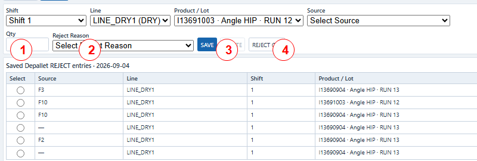

หมายเลข: 1 Qty · 2 Reject Reason · 3 SAVE · 4 REJECT CAL

## 7. PRINT REPORTS

1. เปิด `PRINT PROD` หรือ `PRINT OEE` ตามรายงานที่ต้องการ
2. เลือกวันที่หรือพารามิเตอร์รายงานที่เกี่ยวข้อง
3. กดปุ่มแสดงรายงาน/ตัวอย่างตามที่มีในหน้าจอจริง
4. ดูตัวอย่างและตรวจวันที่, Lot, เครื่อง/กะ และยอดรวมก่อนพิมพ์
5. สั่งพิมพ์จากหน้าต่างพิมพ์ของโปรแกรม/เบราว์เซอร์ และเลือกเครื่องพิมพ์จริง

ตรวจหน้าตัวอย่างก่อนพิมพ์ทุกครั้ง หากข้อมูลผิด ให้กลับไปแก้หน้าบันทึกต้นทาง แล้วเปิดรายงานใหม่

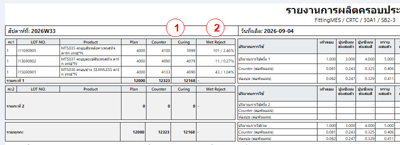

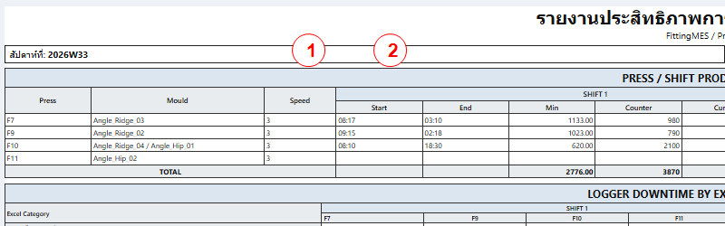

หมายเลข: 1 สัปดาห์รายงาน · 2 วันที่ผลิต · ตรวจตัวอย่างก่อนใช้ปุ่ม `PRINT` ในหน้าจอจริง

## ก่อนกด SAVE ทุกครั้ง

- ตรวจ `Production Date`, `Shift`, `Line`, `Product/Lot` และเครื่องให้ตรงกับงานจริง
- ตรวจจำนวนและหน่วย รวมทั้งช่องที่ยังว่างหรือกรอกผิดช่อง
- ถ้าระบบแจ้งข้อผิดพลาด ให้แก้ข้อมูลตามข้อความแจ้งเตือน แล้วกด `SAVE` อีกครั้ง
- ห้ามกดซ้ำต่อเนื่องโดยไม่ตรวจรายการก่อน หากไม่แน่ใจว่าบันทึกสำเร็จหรือไม่ ให้ตรวจรายการที่แสดงอยู่/สอบถามหัวหน้างานก่อน เพื่อป้องกันข้อมูลซ้ำ
